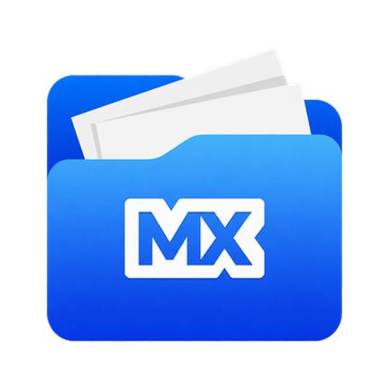

#  MiuiX Files

Gerenciador de arquivos para Android rápido, leve e completo, construído em **Jetpack Compose** com **MIUIX** ([compose-miuix-ui](https://github.com/compose-miuix-ui/miuix)).

Recria a experiência 1:1, o fluxo de navegação e o conjunto de ferramentas do clássico **ES File Explorer Dark**, mas com código 100% moderno, limpo, sem anúncios, sem rastreadores e sem bloatware.

---

## ✨ Recursos

- **Interface 1:1 Estilo ES File Explorer Dark + MIUIX**:
  - Sistema de **múltiplas janelas/abas** no topo com alternância rápida e gerenciador de janelas abertas.
  - Menu lateral (*Drawer*) com acesso rápido a **Local**, **Favoritos**, **Biblioteca** e **Ferramentas**.
  - Diálogos, switches e animações suaves com física elástica MIUIX.
- **Página Inicial (Home Dashboard)**:
  - Medidores circulares de armazenamento (**Interno** e **Cartão SD**) com exibição de espaço usado, total e atalho direto para o **Analisador de Espaço**.
  - Grade de categorias e ferramentas: **Fotografias**, **Música**, **Filmes**, **Livros**, **APP**, **Download**, **Analisador de Espaço**, **Reciclagem**, **Transferir** e **Gerenciador de APPs**.
  - Seção de **Arquivos Recentes** com agrupamento e acesso rápido.
- **Explorador de Arquivos Avançado**:
  - Barra de caminho (*Breadcrumbs*) rolável com tag de porcentagem de uso do disco integrada.
  - Visualização em **Grade** e **Lista** com suporte a **pinça com dois dedos (*pinch-to-zoom*)** para alternar o modo de exibição e ícones de apps nas pastas correspondentes.
  - **Drag & Drop Completo (1:1)**: arraste pastas ou múltiplos arquivos diretamente para outras pastas, para segmentos da barra de caminho ou para os **4 cantos de ação rápida** (*Compartilhar*, *Copiar*, *Enviar* e *Excluir*).
  - **Aba lateral de Área de Transferência (*Clipboard*)** retrátil na borda direita para colar ou limpar arquivos copiados/cortados de qualquer pasta.
  - **Operações de Arquivo**: Copiar, Cortar/Mover com barra de progresso em tempo real, Excluir (com opção de mover para a **Reciclagem**), Renomear único e **Renomeação em Lote (*Batch Rename*)**, Criar pastas e arquivos.
  - **Compactação e Extração `.ZIP`**: criação de arquivos `.zip` com nome personalizado e extração direta (para subpasta ou diretório atual) com progresso em tempo real.
  - **Propriedades e Checksums**: inspeção detalhada do arquivo/pasta com cálculo de hashes **MD5** e **SHA-1** copiáveis em um toque.
- **Visualizadores e Editores Integrados**:
  - **Visualizador de Imagens**, **Reprodutor de Áudio**, **Editor de Texto** integrado (com contador de linhas/caracteres, busca e salvamento direto), **Visualizador de Arquivos `.ZIP`** e **Inspetor de APKs** (versão, pacote, permissões, instalação e inspeção interna).
- **📊 Analisador de Espaço & 🧹 Limpeza (Cleaner)**:
  - Varredura detalhada de uso de armazenamento por categorias, pastas grandes, arquivos grandes, duplicados e arquivos temporários/cache.
  - **Reciclagem** integrada com suporte a restauração ou exclusão permanente.
- **📱 Gerenciador de APPs**:
  - Listagem de aplicativos instalados com busca, seleção múltipla, **Backup de APKs** (`backups/apps`), compartilhamento direto do APK, informações do sistema e desinstalação.

---

## 🛠️ Comandos de Build

| Ação | Comando |
| :--- | :--- |
| **Compilar APK Release** | `./gradlew assembleRelease` |
| **Compilar APK Debug** | `./gradlew assembleDebug` |
| **Instalar Release no dispositivo** | `adb install -r app/build/outputs/apk/release/app-release.apk` |
| **Limpar build** | `./gradlew clean` |

---

## 📦 Tecnologias

- **Pacote**: `miuix.files`
- **Linguagem**: Kotlin
- **UI Toolkit**: Jetpack Compose
- **Design System**: [compose-miuix-ui](https://github.com/compose-miuix-ui/miuix) (`miuix-ui`, `miuix-icons`, `miuix-blur`, `miuix-preference`)
- **Concorrência**: Kotlin Coroutines & StateFlow
- **SDK**: `minSdk = 26` (Android 8.0+) | `targetSdk = 36` | `compileSdk = 37`
